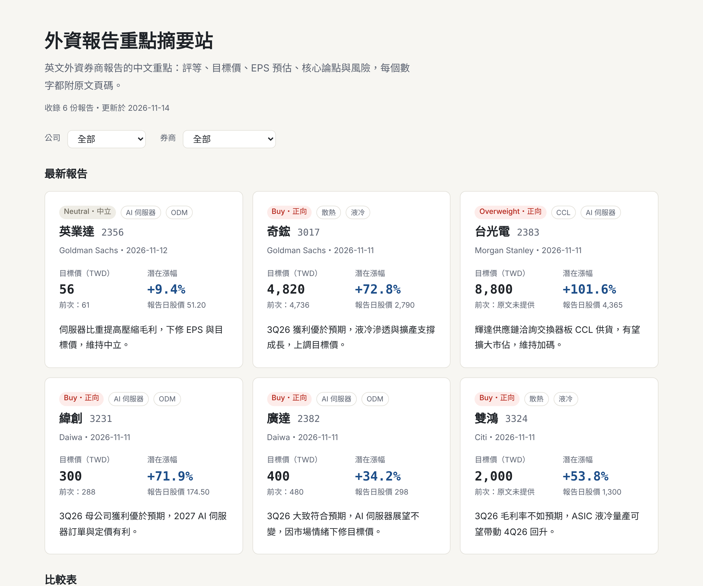
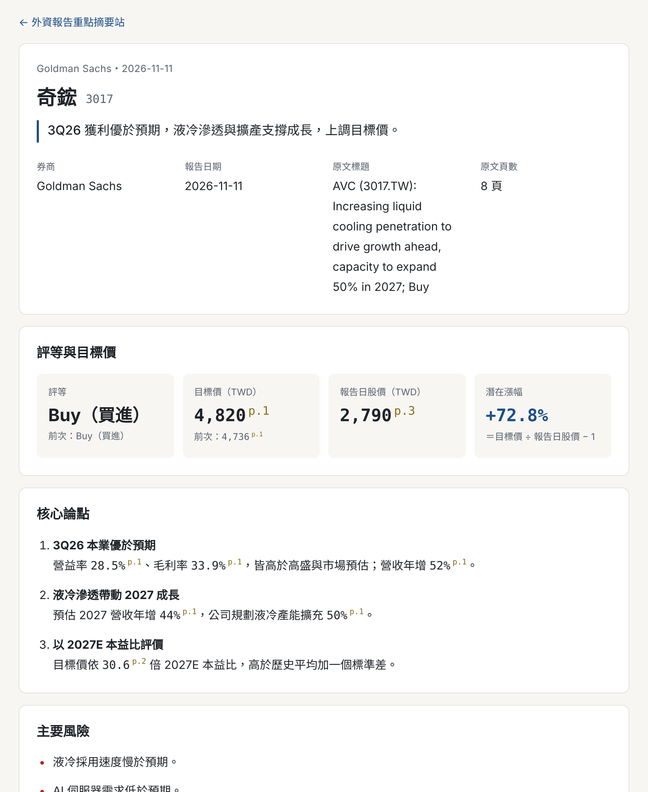

# 外資報告重點摘要站

把英文外資券商報告整理成中文重點頁：一份報告一頁，評等、目標價、EPS 預估、核心論點與風險一目了然，**每個數字都標出原文頁碼**。

🔗 網站：<https://notcharles-chen.github.io/broker-report-digest/>



## 為什麼做這個

研究一檔台股時，常常要同時讀好幾家外資的英文報告。每份報告動輒十幾頁，評等、目標價、EPS 預估散落在封面、內文和附表裡，各家的格式也不一樣，人工整理很花時間。直接請 AI 摘要雖然快，卻可能把數字看錯，甚至寫出原文沒有的數字。

這個網站的做法是：用固定格式整理每一份報告，而且每個數字都附上原文頁碼，讀者隨時可以回頭核對。

## 網站上有什麼

- **首頁報告卡片**：每份報告一張卡片，列出公司、券商、日期、評等、目標價（含前次）、潛在漲幅與一句話結論。可依公司或券商篩選。
- **比較表**：所有報告放在同一張表，點欄位標題即可依日期、目標價、潛在漲幅等排序，方便比較不同券商對同一檔股票、或同一券商對不同股票的看法。
- **報告頁**：每頁固定 6 個區塊，順序一致，換一份報告也不用重新找位置：

| 區塊 | 內容 |
|---|---|
| 基本資料 | 公司、券商、報告日期、原文標題、頁數、一句話結論 |
| 評等與目標價 | 評等（本次／前次）、目標價（本次／前次）、報告日股價、潛在漲幅 |
| 核心論點 | 券商最主要的 3 個理由 |
| 主要風險 | 券商列出的 2～4 項風險 |
| EPS 預估 | 各年度本次預估、前次預估與調整幅度 |
| 原文頁碼對照 | 每一頁原文講了什麼、本頁引用了哪些數字 |



## 怎麼看一頁報告

- **數字右上角的 `p.3`**：代表這個數字出自原文第 3 頁。頁碼對應的內容整理在頁面最下方的「原文頁碼對照」。
- **藍色數字**：自行計算的值，例如潛在漲幅、EPS 調整幅度，不帶頁碼。公式固定：
  - 潛在漲幅 ＝（目標價 ÷ 報告日股價 − 1）× 100
  - 調整幅度 ＝（本次預估 ÷ 前次預估 − 1）× 100
  - 皆四捨五入到小數 1 位。
- **評等顏色**：依台股習慣，紅色＝正向（Buy、Overweight 等）、灰色＝中立、綠色＝負向。評等一律保留券商原文用詞，括號內附中文。
- **「原文未提供」**：原文沒有寫的數字就留空，不推估、不補。例如部分報告沒有列出前次目標價。

## 數字怎麼確保正確

1. **一律附頁碼**：取自原文的數字都必須標出頁碼；找不到頁碼的數字不會放上網站。
2. **自動檢查**：每次新增或修改後，都會執行 `scripts/check.py`。它會檢查：
   - 每個原文數字後面都有頁碼，且頁碼都列在「原文頁碼對照」表裡
   - 潛在漲幅是否依公式算對
   - 首頁資料與報告頁的目標價、股價、一句話結論是否一致
   - 6 個區塊是否齊全、順序正確
   - 檔名、連結、券商代碼、評等用詞是否符合規範
3. **計算公式公開**：所有計算值都寫明公式，讀者可以自行驗算。

## 怎麼新增一份報告

這個網站設計成由 AI（Claude）依照固定規則持續擴充。完整規則寫在 [`CLAUDE.md`](CLAUDE.md)，包含頁面格式、數字標記方式、命名規則與檢查流程。

新增一份報告時，只要把報告 PDF 交給 Claude，並說「依 CLAUDE.md 第 7 節新增這份報告」。Claude 會依序：

1. 從原文確認券商、發布日與股票代號，組出檔名，例如 `20261111-gs-3017`。
2. 複製 `templates/report.html`，逐頁讀原文、填寫 6 個區塊，並為每個數字標上頁碼。
3. 在 `data/reports.json` 登記這份報告，首頁卡片和比較表會自動出現。
4. 執行 `python3 scripts/check.py`，修到 0 錯誤為止。

規則有任何調整，都記錄在 [`log.md`](log.md)。

## 專案結構

```
index.html               首頁（報告卡片＋比較表）
reports/                 報告頁，一份報告一個 HTML 檔
templates/report.html    報告頁模板
data/reports.json        報告索引（首頁的資料來源）
data/brokers.json        券商代碼表
assets/                  樣式、首頁程式、截圖
scripts/check.py         自動檢查
CLAUDE.md                給 AI 的專案規則
log.md                   規則變更紀錄
```

純靜態網站：HTML、CSS、JavaScript，不需要任何建置工具或套件，透過 GitHub Pages 發布。

## 本機預覽

需要 Python 3：

```bash
python3 -m http.server 8000   # 開啟 http://localhost:8000
python3 scripts/check.py      # 執行自動檢查
```

首頁用 JavaScript 讀取 `data/reports.json`，直接雙擊開啟 `index.html` 會讀不到資料，請用上面的方式開啟。
